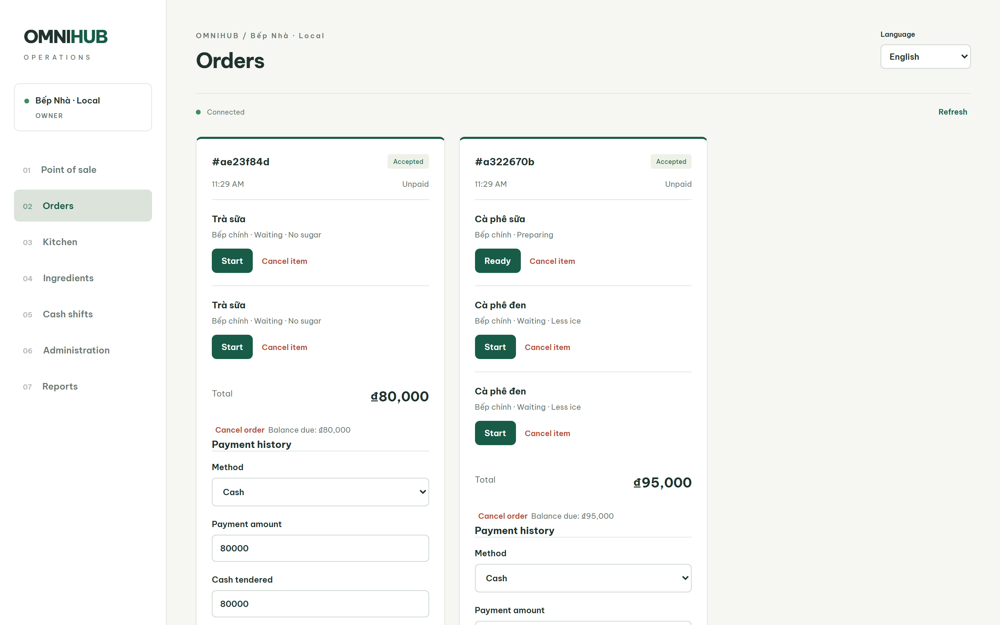
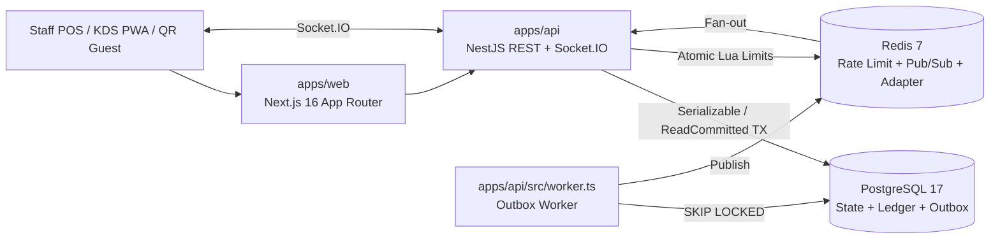

# OMNIHUB

A restaurant operations app for POS orders, kitchen workflows, inventory, and checkout.

[](https://github.com/ngophong123/OMNIHUB/actions/workflows/ci.yml)
[](https://github.com/ngophong123/OMNIHUB/actions/workflows/security.yml)


| Order Management & Checkout | Offline-Capable Kitchen Display (KDS) |
|---|---|
|  |  |

## What it does

OMNIHUB handles the flow from POS and QR orders to kitchen preparation, payment, and shift close. It addresses a few practical problems: concurrent orders competing for the same stock, kitchen screens losing connectivity, and payment totals drifting from shift records.

PostgreSQL stores transactional state. The API uses `Serializable` transactions, append-only ledgers, and a transactional outbox. Redis handles rate limits and realtime fan-out across API replicas. Tenant- and store-scoped access uses `(tenantId, storeId)`; the server selects socket rooms.

The current suites cover `85` unit tests, `36` PostgreSQL integration tests, `9` Redis tests, and `10` Playwright E2E workflows. GitHub Actions also runs CodeQL and dependency audits.

## How it works

### Stock & locking

Orders can compete for the same ingredients. The API aggregates recipe needs in `Decimal(18,3)`, locks ingredient rows in sorted ID order, and applies conditional stock updates inside `Serializable` transactions ([`operations.ts`](https://github.com/ngophong123/OMNIHUB/blob/d72a03d0edfbc2cd45d067b3c6b33819531296e6/apps/api/src/operations.ts#L57-L76), [`migration.sql`](https://github.com/ngophong123/OMNIHUB/blob/d72a03d0edfbc2cd45d067b3c6b33819531296e6/prisma/migrations/202610210002_invariants/migration.sql#L1-L26), [`operations.test.ts`](https://github.com/ngophong123/OMNIHUB/blob/d72a03d0edfbc2cd45d067b3c6b33819531296e6/tests/integration/operations.test.ts)).

### Outbox & realtime

Mutations write `Outbox`, `Audit`, and `CommandReceipt` rows in the same PostgreSQL transaction; a worker claims batches with `FOR UPDATE SKIP LOCKED` and publishes them to Redis Pub/Sub using at-least-once delivery. API replicas use a process-local FIFO cache of up to `2,048` event IDs to suppress recently seen duplicates; the cache is lost on restart, so clients refetch authoritative state from REST ([`commands.ts`](https://github.com/ngophong123/OMNIHUB/blob/d72a03d0edfbc2cd45d067b3c6b33819531296e6/apps/api/src/commands.ts#L39-L58), [`outbox.ts`](https://github.com/ngophong123/OMNIHUB/blob/d72a03d0edfbc2cd45d067b3c6b33819531296e6/apps/api/src/outbox.ts#L150-L240), [`realtime.ts`](https://github.com/ngophong123/OMNIHUB/blob/d72a03d0edfbc2cd45d067b3c6b33819531296e6/apps/api/src/realtime.ts#L877-L898), [`realtime-replicas.test.ts`](https://github.com/ngophong123/OMNIHUB/blob/d72a03d0edfbc2cd45d067b3c6b33819531296e6/tests/redis/realtime-replicas.test.ts#L157-L174)).

### Offline KDS & device sync

The KDS PWA caches tickets and queues ordered `START`/`READY` commands in IndexedDB, stopping per-order replay on version conflicts. Heartbeats use atomic conditional `ReadCommitted` updates (`revokedAt IS NULL`) to avoid `P2034` bursts; registration and revocation use `Serializable` transactions, and item commands lock active devices with `FOR SHARE` ([`kitchen-offline.ts`](https://github.com/ngophong123/OMNIHUB/blob/d72a03d0edfbc2cd45d067b3c6b33819531296e6/apps/web/src/app/kitchen-offline.ts#L14-L105), [`http.ts`](https://github.com/ngophong123/OMNIHUB/blob/d72a03d0edfbc2cd45d067b3c6b33819531296e6/apps/api/src/http.ts#L40-L59), [`http.ts`](https://github.com/ngophong123/OMNIHUB/blob/d72a03d0edfbc2cd45d067b3c6b33819531296e6/apps/api/src/http.ts#L162-L221), [`workflow.spec.ts`](https://github.com/ngophong123/OMNIHUB/blob/d72a03d0edfbc2cd45d067b3c6b33819531296e6/tests/e2e/workflow.spec.ts#L272-L329), [`m2-realtime-revocation.test.ts`](https://github.com/ngophong123/OMNIHUB/blob/d72a03d0edfbc2cd45d067b3c6b33819531296e6/tests/integration/m2-realtime-revocation.test.ts)).

### Auth rate limiting

Login uses an IP rate limit and a SHA-256 per-account lockout (`10` failures / `15m`); Redis Lua checks the limit before `scrypt`, and login fails with `503` if Redis is unavailable ([`rate-limit.ts`](https://github.com/ngophong123/OMNIHUB/blob/d72a03d0edfbc2cd45d067b3c6b33819531296e6/apps/api/src/rate-limit.ts#L18-L66), [`auth.ts`](https://github.com/ngophong123/OMNIHUB/blob/d72a03d0edfbc2cd45d067b3c6b33819531296e6/apps/api/src/auth.ts#L126-L158), [`rate-limit.test.ts`](https://github.com/ngophong123/OMNIHUB/blob/d72a03d0edfbc2cd45d067b3c6b33819531296e6/tests/unit/rate-limit.test.ts)).

### Checkout & cash shifts

Checkout uses integer VND amounts, and cash payments lock the open-shift row with `FOR UPDATE`. The flow supports bill splits, manually verified bank transfers, and manager-approved compensating refunds capped at item and payment totals; cash refunds add a `REFUND` movement without changing the original payment or restocking ingredients ([`payments.ts`](https://github.com/ngophong123/OMNIHUB/blob/d72a03d0edfbc2cd45d067b3c6b33819531296e6/apps/api/src/payments.ts#L28-L92), [`payments.ts`](https://github.com/ngophong123/OMNIHUB/blob/d72a03d0edfbc2cd45d067b3c6b33819531296e6/apps/api/src/payments.ts#L116-L163), [`cash-shifts.ts`](https://github.com/ngophong123/OMNIHUB/blob/d72a03d0edfbc2cd45d067b3c6b33819531296e6/apps/api/src/cash-shifts.ts#L65-L97), [`operations.test.ts`](https://github.com/ngophong123/OMNIHUB/blob/d72a03d0edfbc2cd45d067b3c6b33819531296e6/tests/integration/operations.test.ts)).

## Stack

- **Frontend:** Next.js `16.4.6` (App Router), React `19.2`, TypeScript `5.9`, `socket.io-client` `4.8`
- **Backend:** NestJS `12.2` (Express `5.1`), Socket.IO `4.8` + `@socket.io/redis-adapter` `8.3`, Zod `4.6`, Helmet `8.1`, `prom-client` `15.1`
- **Data & Testing:** PostgreSQL `17` (Docker Compose/CI), Prisma `6.19` (`36` models, `13` migrations), Redis `7` (`ioredis` `5.8`), Vitest `4.1`, Playwright `1.56`

## Architecture



## Quick Start

You need Node.js `>=22.14.0`, `pnpm 12.4.1`, and Docker Desktop for PostgreSQL 17 and Redis 7. In Windows PowerShell, use `pnpm.cmd` if the execution policy blocks `pnpm.ps1`.

```powershell
pnpm install --frozen-lockfile
Copy-Item .env.example .env    # macOS/Linux: cp .env.example .env
# Edit .env: set SEED_DEMO=true and a local DEMO_PASSWORD (>= 12 chars).

pnpm infra:up
pnpm db:generate
pnpm db:migrate
pnpm db:seed
pnpm --filter @omnihub/contracts build

pnpm dev      # Terminal 1: Web (http://localhost:3000) + API (http://127.0.0.1:4000)
pnpm worker   # Terminal 2: PostgreSQL Outbox -> Redis Pub/Sub worker
```

After startup, check `http://127.0.0.1:4000/health` (`200`), `http://127.0.0.1:4000/ready` (`200`), and `http://localhost:3000` (`200`). The sample store ID is `22222222-2222-4222-8222-222222222222`. Demo accounts: `owner@local.omnihub.test`, `cashier@local.omnihub.test`, `kitchen@local.omnihub.test`, and `inventory@local.omnihub.test`.

## Tests

Run these checks locally:

- `pnpm typecheck`, `pnpm lint`, `pnpm build`, `pnpm security:hygiene`, `pnpm audit --prod --audit-level high`
- `pnpm test`: `85` unit tests across `9` files (domain math, auth/commands, error redaction, rate-limit Lua, structured logging, Prometheus metrics, `P2034` retries)
- `pnpm test:integration`: `36` PostgreSQL integration tests across `4` files (stock races, idempotency, splits, refunds, cash shifts, `SKIP LOCKED` outbox, `/metrics`, device revocation)
- `pnpm test:redis`: `9` Redis integration tests across `3` files (multi-replica rate limits, Socket.IO Redis adapter fan-out, instant revocation, Redis 7 ACLs)
- `pnpm test:e2e:ci`: `10` Playwright Chromium end-to-end workflows against built `api`, `worker`, `web`, PostgreSQL 17, and Redis 7

## Known Limitations

- The project uses sample data and has not been piloted in a live restaurant. Physical hardware, LAN/printer cutover, and operator UAT have not been tested.
- Card checkout is sandbox-only. The `CARD` route uses `LabeledCardSandboxAdapter` (`SANDBOX_ONLY`); real acquiring and signed provider webhooks are not implemented.
- There is no off-machine disaster recovery or WAL point-in-time recovery. Local staging has logical `pg_dump` and Restic scripts, but off-machine backup storage, independent alerting, and WAL archiving are not configured.
- Routes are still wired through one `ApiController` in `apps/api/src/http.ts`; the `M2-T12` feature-module refactor is pending. Staff sessions are tied to one store at login. See [Known Limitations](docs/KNOWN_LIMITATIONS.md).

## Roadmap

- Split `apps/api/src/http.ts` into NestJS feature modules with constructor-injected providers (`M2-T12`).
- Add multi-store runtime switching and multi-warehouse inventory transfers.
- Set up and verify off-machine encrypted backup recovery and external alerting.
- Integrate a real payment provider with signed webhook verification, then run pilot UAT.

## Documentation

- [Architecture](docs/ARCHITECTURE.md) — Monorepo layout, concurrency, outbox delivery, and security boundaries.
- [Order-to-Cash Flow](docs/ORDER-TO-CASH-FLOW.md) — Order, inventory, kitchen, payment, and shift lifecycle.
- [Known Limitations](docs/KNOWN_LIMITATIONS.md) — Current limits, pilot NO-GO status, and out-of-scope items.
- ADRs: [0001 Serializable Inventory Ledger](docs/adr/0001-serializable-inventory-ledger.md) · [0002 Transactional Outbox & Redis Adapter](docs/adr/0002-transactional-outbox-and-redis-adapter.md) · [0003 Kitchen Device Sync & Revocation](docs/adr/0003-kitchen-device-sync-and-revocation.md) · [Contributing](CONTRIBUTING.md)
