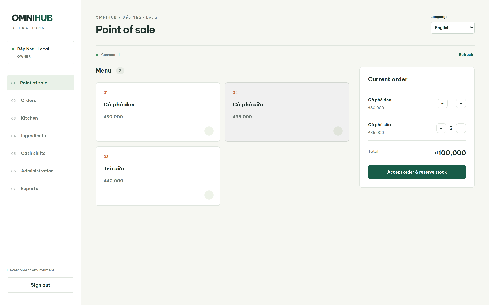

# OMNIHUB

[](https://github.com/ngophong123/OMNIHUB/actions/workflows/ci.yml)
[](https://github.com/ngophong123/OMNIHUB/actions/workflows/security.yml)

Restaurant operations platform connecting orders, kitchen, inventory, and checkout.

## Screenshots



| Order Management & Checkout | Offline-Capable Kitchen Display (KDS) |
|---|---|
|  |  |

## Core Capabilities

- **POS & QR Table Ordering:** Server-priced orders with product variants, modifiers, immutable recipe snapshots, and rotatable QR table sessions.
- **Atomic Ingredient Inventory:** `Decimal(18,3)` stock reservations on order acceptance, consumption on kitchen start, release on pre-start cancel, and waste tracking post-start — backed by PostgreSQL `CHECK` constraints and append-only ledger triggers ([`operations.ts`](https://github.com/ngophong123/OMNIHUB/blob/d72a03d0edfbc2cd45d067b3c6b33819531296e6/apps/api/src/operations.ts#L57-L76), [`migration.sql`](https://github.com/ngophong123/OMNIHUB/blob/d72a03d0edfbc2cd45d067b3c6b33819531296e6/prisma/migrations/202610210002_invariants/migration.sql#L1-L26)).
- **Offline-Capable KDS & Multi-Replica Realtime:** IndexedDB command queue (`START`/`READY`) with conflict blocking (`CONFLICT`/`BLOCKED`), transactional `Outbox` worker (`FOR UPDATE SKIP LOCKED`), `@socket.io/redis-adapter` fan-out, and safe `ReadCommitted` device heartbeats ([`outbox.ts`](https://github.com/ngophong123/OMNIHUB/blob/d72a03d0edfbc2cd45d067b3c6b33819531296e6/apps/api/src/outbox.ts#L150-L240), [`realtime.ts`](https://github.com/ngophong123/OMNIHUB/blob/d72a03d0edfbc2cd45d067b3c6b33819531296e6/apps/api/src/realtime.ts#L518-L620), [`http.ts`](https://github.com/ngophong123/OMNIHUB/blob/d72a03d0edfbc2cd45d067b3c6b33819531296e6/apps/api/src/http.ts#L40-L59), [`http.ts`](https://github.com/ngophong123/OMNIHUB/blob/d72a03d0edfbc2cd45d067b3c6b33819531296e6/apps/api/src/http.ts#L162-L221)).
- **Checkout, Splits, Refunds & Cash Shifts:** Integer VND settlement, bill splits, manually verified bank transfers, manager-approved compensating refunds, and shift discrepancy reconciliation (`OPEN -> CLOSING -> CLOSED`) ([`payments.ts`](https://github.com/ngophong123/OMNIHUB/blob/d72a03d0edfbc2cd45d067b3c6b33819531296e6/apps/api/src/payments.ts#L28-L92), [`cash-shifts.ts`](https://github.com/ngophong123/OMNIHUB/blob/d72a03d0edfbc2cd45d067b3c6b33819531296e6/apps/api/src/cash-shifts.ts#L65-L97)).
- **Multi-Tenant Security:** `(tenantId, storeId)` isolation, `scrypt` hashed credentials, SHA-256 capability tokens, and fail-closed dual-key Redis Lua rate limiting (`503` on Redis outage) ([`rate-limit.ts`](https://github.com/ngophong123/OMNIHUB/blob/d72a03d0edfbc2cd45d067b3c6b33819531296e6/apps/api/src/rate-limit.ts#L18-L66)).

## Tech Stack

- **Frontend:** Next.js `16.4.6` (App Router), React `19`, TypeScript `5.9`, `socket.io-client`
- **Backend:** NestJS `12.2` (Express `5`), Socket.IO `4.8` + `@socket.io/redis-adapter`, Zod `4.6`, Helmet `8.1`, Prometheus (`prom-client`)
- **Data & Testing:** PostgreSQL `17/18`, Prisma `6.19` (`36` models, `13` migrations), Redis `7` (`ioredis`), Vitest `4.1`, Playwright `1.56`

## Architecture


## Quick Start

Requires Node.js `>=22.14.0`, `pnpm 12.4.1`, and Docker (for local PostgreSQL 17 and Redis 7).

```sh
pnpm install
cp .env.example .env
# Edit .env: set SEED_DEMO=true and DEMO_PASSWORD (>= 12 chars) for sample accounts.

pnpm infra:up
pnpm db:generate
pnpm db:migrate
pnpm db:seed
pnpm --filter @omnihub/contracts build

pnpm dev      # Terminal 1: Next.js web (http://localhost:3000) + NestJS API (http://localhost:4000)
pnpm worker   # Terminal 2: PostgreSQL Outbox -> Redis Pub/Sub worker
```

Sample store ID: `22222222-2222-4222-8222-222222222222` · Accounts: `owner@local.omnihub.test`, `cashier@local.omnihub.test`, `kitchen@local.omnihub.test`, `inventory@local.omnihub.test`.

## Engineering Quality & Testing

- **Unit (`pnpm test`):** `85` tests across `9` files covering domain math, auth/commands, error redaction, rate-limit Lua behavior, logging, metrics, and `P2034` retries ([`rate-limit.test.ts`](https://github.com/ngophong123/OMNIHUB/blob/d72a03d0edfbc2cd45d067b3c6b33819531296e6/tests/unit/rate-limit.test.ts)).
- **PostgreSQL Integration (`pnpm test:integration`):** `36` tests across `4` files verifying stock races, idempotency, splits, refunds, cash shifts, tenant isolation, `SKIP LOCKED` outbox delivery, and device revocation races ([`operations.test.ts`](https://github.com/ngophong123/OMNIHUB/blob/d72a03d0edfbc2cd45d067b3c6b33819531296e6/tests/integration/operations.test.ts), [`m2-realtime-revocation.test.ts`](https://github.com/ngophong123/OMNIHUB/blob/d72a03d0edfbc2cd45d067b3c6b33819531296e6/tests/integration/m2-realtime-revocation.test.ts)).
- **Redis & Browser E2E (GitHub Actions):** `9` Redis replica/rate-limit tests across `3` suites ([`realtime-replicas.test.ts`](https://github.com/ngophong123/OMNIHUB/blob/d72a03d0edfbc2cd45d067b3c6b33819531296e6/tests/redis/realtime-replicas.test.ts)) and `10` Playwright E2E workflows run on PostgreSQL 17 and Redis 7 alongside V8 coverage floors, CodeQL, `pnpm audit --prod`, and secret hygiene checks.

## Documentation

- [Architecture](docs/ARCHITECTURE.md) — Monorepo structure, concurrency model, outbox realtime, and security boundaries.
- [Order-to-Cash Flow](docs/ORDER-TO-CASH-FLOW.md) — End-to-end order, inventory, kitchen, payment, and shift lifecycle.
- [Known Limitations](docs/KNOWN_LIMITATIONS.md) — Pilot NO-GO status, current boundaries, and out-of-scope features.
- ADRs: [0001 Serializable Inventory Ledger](docs/adr/0001-serializable-inventory-ledger.md) · [0002 Transactional Outbox & Redis Adapter](docs/adr/0002-transactional-outbox-and-redis-adapter.md) · [0003 Kitchen Device Sync & Revocation](docs/adr/0003-kitchen-device-sync-and-revocation.md)
- [Contributing](CONTRIBUTING.md) · Archived internal engineering specs in [docs/internal/](docs/internal/).

## Status

Portfolio project using sample data only. Not deployed to live restaurants, does not process real card payments (`CARD` is `SANDBOX_ONLY`), and is not production-ready (see [Known Limitations](docs/KNOWN_LIMITATIONS.md)).
