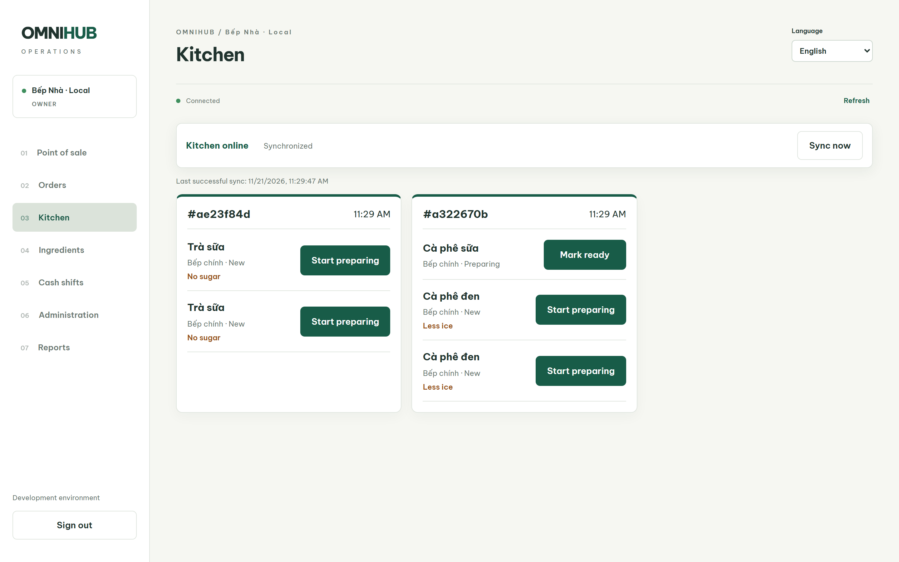

# OMNIHUB

[](https://github.com/ngophong123/OMNIHUB/actions/workflows/ci.yml)
[](https://github.com/ngophong123/OMNIHUB/actions/workflows/security.yml)

Restaurant operations platform covering POS ordering, atomic ingredient inventory, offline-capable kitchen display (KDS), QR table ordering, payments, and cashier shift reconciliation. Built as a TypeScript monorepo focused on PostgreSQL transactional invariants, multi-tenant isolation, and multi-replica realtime coordination.

> **Note:** This is a portfolio project using sample data only. It is not deployed to live restaurants, does not process real payment transactions, and is not production-ready (see [Known Limitations](docs/KNOWN_LIMITATIONS.md)).

## Screenshots


| Order Management & Payment Settlement | Offline-Capable Kitchen Display (KDS) |
|---|---|
|  |  |

## Architecture


- **Monorepo:** `apps/web` (Next.js 16.4.6, React 19), `apps/api` (NestJS 12.2, Express 5, Socket.IO 4.8 + `@socket.io/redis-adapter`), `packages/contracts` (Zod 4.6), `prisma` (Prisma 6.19, 36 models, 13 migrations).
- **Data & Verification:** PostgreSQL 17/18, Redis 7 (`ioredis`), TypeScript 5.9 (`strict`), Vitest 4.1, Playwright 1.56, Prometheus (`prom-client`), Helmet 8.1.

## Engineering Problems Solved

- **Inventory oversell & deadlock prevention:** Order acceptance aggregates recipe ingredients in `Decimal(18,3)` base units, sorts by `ingredientId`, and runs atomic conditional updates (`onHand - reserved >= quantity`) inside `Serializable` transactions with PostgreSQL `CHECK` constraints and append-only triggers on `Movement`, `Audit`, and `Payment` ([`operations.ts`](https://github.com/ngophong123/OMNIHUB/blob/d72a03d0edfbc2cd45d067b3c6b33819531296e6/apps/api/src/operations.ts#L57-L76), [`migration.sql`](https://github.com/ngophong123/OMNIHUB/blob/d72a03d0edfbc2cd45d067b3c6b33819531296e6/prisma/migrations/202610210002_invariants/migration.sql#L1-L26), [`operations.test.ts`](https://github.com/ngophong123/OMNIHUB/blob/d72a03d0edfbc2cd45d067b3c6b33819531296e6/tests/integration/operations.test.ts)).
- **Multi-replica realtime without dual-write bugs:** Mutations commit `Outbox` rows in the same PostgreSQL transaction; a standalone worker polls with `FOR UPDATE SKIP LOCKED` within a bounded batch budget, publishes to Redis Pub/Sub, and API replicas broadcast through `@socket.io/redis-adapter` with `eventId` FIFO deduplication ([`outbox.ts`](https://github.com/ngophong123/OMNIHUB/blob/d72a03d0edfbc2cd45d067b3c6b33819531296e6/apps/api/src/outbox.ts#L150-L240), [`realtime.ts`](https://github.com/ngophong123/OMNIHUB/blob/d72a03d0edfbc2cd45d067b3c6b33819531296e6/apps/api/src/realtime.ts#L518-L620), [`realtime-replicas.test.ts`](https://github.com/ngophong123/OMNIHUB/blob/d72a03d0edfbc2cd45d067b3c6b33819531296e6/tests/redis/realtime-replicas.test.ts)).
- **Offline KDS replay & device revocation races:** The KDS PWA queues ordered `START`/`READY` commands in IndexedDB and stops on version conflicts (`CONFLICT`/`BLOCKED`) instead of last-write-wins. Steady-state device heartbeats use atomic conditional `ReadCommitted` updates (`revokedAt IS NULL`) to avoid `P2034` bursts, while device creation/revocation run in `Serializable` transactions and item commands lock active devices `FOR SHARE` ([`http.ts`](https://github.com/ngophong123/OMNIHUB/blob/d72a03d0edfbc2cd45d067b3c6b33819531296e6/apps/api/src/http.ts#L40-L59), [`http.ts`](https://github.com/ngophong123/OMNIHUB/blob/d72a03d0edfbc2cd45d067b3c6b33819531296e6/apps/api/src/http.ts#L162-L221), [`m2-realtime-revocation.test.ts`](https://github.com/ngophong123/OMNIHUB/blob/d72a03d0edfbc2cd45d067b3c6b33819531296e6/tests/integration/m2-realtime-revocation.test.ts)).
- **Dual-key auth rate limiting & fail-closed ingress:** Login combines an IP window cap with a SHA-256 per-account lockout (`10` failures / `15m`) evaluated in Redis Lua before `scrypt` and reset via `PEXPIRE 0` (no `DEL` required for Redis 7 ACLs), returning `503` if Redis is unavailable ([`rate-limit.ts`](https://github.com/ngophong123/OMNIHUB/blob/d72a03d0edfbc2cd45d067b3c6b33819531296e6/apps/api/src/rate-limit.ts#L18-L66), [`rate-limit.test.ts`](https://github.com/ngophong123/OMNIHUB/blob/d72a03d0edfbc2cd45d067b3c6b33819531296e6/tests/unit/rate-limit.test.ts)).
- **Order-to-cash settlement & shift reconciliation:** Integer VND accounting enforces open-shift row locking (`FOR UPDATE`) for cash payments, bill splits, manually verified bank transfers (`PENDING -> SETTLED/FAILED`), manager-approved compensating refunds that never restock consumed ingredients, and shift discrepancy approval ([`payments.ts`](https://github.com/ngophong123/OMNIHUB/blob/d72a03d0edfbc2cd45d067b3c6b33819531296e6/apps/api/src/payments.ts#L28-L92), [`cash-shifts.ts`](https://github.com/ngophong123/OMNIHUB/blob/d72a03d0edfbc2cd45d067b3c6b33819531296e6/apps/api/src/cash-shifts.ts#L65-L97)).

## Running Locally

Requires Node.js `>=22.14.0`, `pnpm 12.4.1`, and Docker (for PostgreSQL 17 and Redis 7).

```sh
pnpm install
cp .env.example .env
# Edit .env: set SEED_DEMO=true and DEMO_PASSWORD (>= 12 chars) for local sample accounts.

pnpm infra:up
pnpm db:generate
pnpm db:migrate
pnpm db:seed
pnpm --filter @omnihub/contracts build

pnpm dev      # Terminal 1: Next.js web (http://localhost:3000) + NestJS API (http://localhost:4000)
pnpm worker   # Terminal 2: PostgreSQL Outbox -> Redis Pub/Sub worker
```

Seeded sample store ID: `22222222-2222-4222-8222-222222222222`. Sample roles: `owner@local.omnihub.test`, `cashier@local.omnihub.test`, `kitchen@local.omnihub.test`, `inventory@local.omnihub.test`.

## Testing & CI

- **Unit (`pnpm test`):** 85 tests across 9 files covering domain math, auth/commands, error redaction, rate-limit Lua behavior, logging, Prometheus metrics, and P2034 retry logic.
- **PostgreSQL Integration (`pnpm test:integration`):** 36 tests across 4 files verifying stock races, idempotency, splits, refunds, cash shifts, tenant isolation, `SKIP LOCKED` outbox delivery, `/metrics`, and device revocation concurrency.
- **Redis & E2E (`pnpm test:redis`, `pnpm test:e2e:ci`):** 3 Redis replica/rate-limit suites and 10 Playwright browser workflows run in GitHub Actions against PostgreSQL 17 and Redis 7 alongside V8 coverage gates, CodeQL, `pnpm audit --prod`, and secret hygiene checks.

## Documentation

- [Architecture](docs/ARCHITECTURE.md) — Monorepo topology, concurrency model, realtime outbox, and security boundaries.
- [Order-to-Cash Flow](docs/ORDER-TO-CASH-FLOW.md) — End-to-end order, inventory, kitchen, payment, and shift lifecycle.
- [Known Limitations](docs/KNOWN_LIMITATIONS.md) — Pilot NO-GO status, current codebase boundaries, and out-of-scope items.
- Architecture Decision Records: [ADR-0001 Serializable Inventory Ledger](docs/adr/0001-serializable-inventory-ledger.md), [ADR-0002 Transactional Outbox & Redis Adapter](docs/adr/0002-transactional-outbox-and-redis-adapter.md), [ADR-0003 Kitchen Device Sync & Revocation](docs/adr/0003-kitchen-device-sync-and-revocation.md).
- [Contributing](CONTRIBUTING.md) and archived detailed engineering specs in [docs/internal/](docs/internal/).
