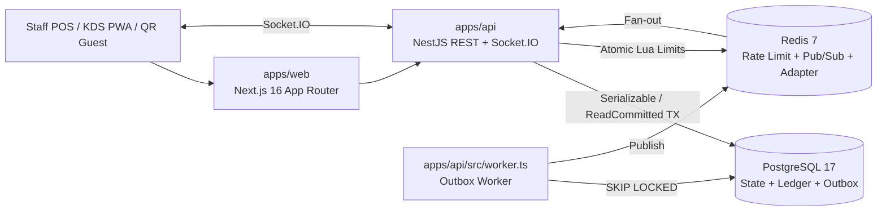

# OMNIHUB

Restaurant operations platform connecting POS orders, kitchen workflows, inventory, and checkout.

[](https://github.com/ngophong123/OMNIHUB/actions/workflows/ci.yml)
[](https://github.com/ngophong123/OMNIHUB/actions/workflows/security.yml)


| Order Management & Checkout | Offline-Capable Kitchen Display (KDS) |
|---|---|
|  |  |

## Overview

- **Problem:** Restaurant operations break down when concurrent POS/QR orders oversell shared ingredients, network drops stall kitchen displays, or partial payments and shift closes drift from ledger totals.
- **Engineering approach:** Keep PostgreSQL as the single transactional source of truth (`Serializable` writes, append-only ledgers, transactional outbox), use Redis strictly for atomic rate limits and multi-replica realtime fan-out, and enforce `(tenantId, storeId)` isolation on every query and socket room.
- Verified against real PostgreSQL, Redis, and Chromium browser suites (`85` unit, `36` PostgreSQL integration, `9` Redis replica/rate-limit, and `10` Playwright E2E workflows) with CodeQL and dependency audits in GitHub Actions.

## Engineering Highlights

- **Inventory oversell protection & deterministic ingredient locking:** Concurrent orders aggregate recipe needs in `Decimal(18,3)` base units, lock ingredients in sorted ID order, and apply conditional updates (`onHand - reserved >= quantity`) inside `Serializable` transactions backed by PostgreSQL `CHECK` constraints and append-only triggers ([`operations.ts`](https://github.com/ngophong123/OMNIHUB/blob/d72a03d0edfbc2cd45d067b3c6b33819531296e6/apps/api/src/operations.ts#L57-L76), [`migration.sql`](https://github.com/ngophong123/OMNIHUB/blob/d72a03d0edfbc2cd45d067b3c6b33819531296e6/prisma/migrations/202610210002_invariants/migration.sql#L1-L26), [`operations.test.ts`](https://github.com/ngophong123/OMNIHUB/blob/d72a03d0edfbc2cd45d067b3c6b33819531296e6/tests/integration/operations.test.ts)).
- **Transactional outbox & multi-replica realtime:** Mutations commit `Outbox`, `Audit`, and `CommandReceipt` rows in the same PostgreSQL transaction; a standalone worker claims batches via `FOR UPDATE SKIP LOCKED` within a bounded time budget and publishes to Redis Pub/Sub, while API replicas fan out via `@socket.io/redis-adapter` with `eventId` deduplication ([`commands.ts`](https://github.com/ngophong123/OMNIHUB/blob/d72a03d0edfbc2cd45d067b3c6b33819531296e6/apps/api/src/commands.ts#L39-L58), [`outbox.ts`](https://github.com/ngophong123/OMNIHUB/blob/d72a03d0edfbc2cd45d067b3c6b33819531296e6/apps/api/src/outbox.ts#L150-L240), [`realtime.ts`](https://github.com/ngophong123/OMNIHUB/blob/d72a03d0edfbc2cd45d067b3c6b33819531296e6/apps/api/src/realtime.ts#L877-L898), [`realtime-replicas.test.ts`](https://github.com/ngophong123/OMNIHUB/blob/d72a03d0edfbc2cd45d067b3c6b33819531296e6/tests/redis/realtime-replicas.test.ts#L157-L174)).
- **Offline KDS replay & revocation concurrency:** The KDS PWA caches tickets and queues ordered `START`/`READY` commands in IndexedDB (`omnihub-kitchen-v1`), stopping per-order replay on version conflicts (`CONFLICT`/`BLOCKED`). Heartbeats use atomic conditional `ReadCommitted` updates (`revokedAt IS NULL`) to avoid `P2034` bursts, while registration/revocation stay `Serializable` and item commands lock active devices `FOR SHARE` ([`kitchen-offline.ts`](https://github.com/ngophong123/OMNIHUB/blob/d72a03d0edfbc2cd45d067b3c6b33819531296e6/apps/web/src/app/kitchen-offline.ts#L14-L105), [`http.ts`](https://github.com/ngophong123/OMNIHUB/blob/d72a03d0edfbc2cd45d067b3c6b33819531296e6/apps/api/src/http.ts#L40-L59), [`http.ts`](https://github.com/ngophong123/OMNIHUB/blob/d72a03d0edfbc2cd45d067b3c6b33819531296e6/apps/api/src/http.ts#L162-L221), [`workflow.spec.ts`](https://github.com/ngophong123/OMNIHUB/blob/d72a03d0edfbc2cd45d067b3c6b33819531296e6/tests/e2e/workflow.spec.ts#L272-L329), [`m2-realtime-revocation.test.ts`](https://github.com/ngophong123/OMNIHUB/blob/d72a03d0edfbc2cd45d067b3c6b33819531296e6/tests/integration/m2-realtime-revocation.test.ts)).
- **Dual-key auth rate limiting & fail-closed ingress:** Login pairs an IP window cap with a SHA-256 per-account lockout (`10` failures / `15m`) checked in Redis Lua before `scrypt`, reset via `PEXPIRE 0` (no `DEL` for Redis 7 ACLs), failing closed (`503`) if Redis is unavailable ([`rate-limit.ts`](https://github.com/ngophong123/OMNIHUB/blob/d72a03d0edfbc2cd45d067b3c6b33819531296e6/apps/api/src/rate-limit.ts#L18-L66), [`auth.ts`](https://github.com/ngophong123/OMNIHUB/blob/d72a03d0edfbc2cd45d067b3c6b33819531296e6/apps/api/src/auth.ts#L126-L158), [`rate-limit.test.ts`](https://github.com/ngophong123/OMNIHUB/blob/d72a03d0edfbc2cd45d067b3c6b33819531296e6/tests/unit/rate-limit.test.ts)).
- **Checkout, refunds & cashier shifts:** Integer VND accounting enforces open-shift row locks (`FOR UPDATE`) for cash payments, bill splits, manually verified bank transfers, manager-approved compensating refunds against settled payments (capped to item/payment totals, adding a shift `REFUND` cash movement for cash payments without mutating original payments or restocking ingredients), and discrepancy approval on shift close ([`payments.ts`](https://github.com/ngophong123/OMNIHUB/blob/d72a03d0edfbc2cd45d067b3c6b33819531296e6/apps/api/src/payments.ts#L28-L92), [`payments.ts`](https://github.com/ngophong123/OMNIHUB/blob/d72a03d0edfbc2cd45d067b3c6b33819531296e6/apps/api/src/payments.ts#L116-L163), [`cash-shifts.ts`](https://github.com/ngophong123/OMNIHUB/blob/d72a03d0edfbc2cd45d067b3c6b33819531296e6/apps/api/src/cash-shifts.ts#L65-L97), [`operations.test.ts`](https://github.com/ngophong123/OMNIHUB/blob/d72a03d0edfbc2cd45d067b3c6b33819531296e6/tests/integration/operations.test.ts)).

## Tech Stack

- **Frontend:** Next.js `16.4.6` (App Router), React `19.2`, TypeScript `5.9`, `socket.io-client` `4.8`
- **Backend:** NestJS `12.2` (Express `5.1`), Socket.IO `4.8` + `@socket.io/redis-adapter` `8.3`, Zod `4.6`, Helmet `8.1`, `prom-client` `15.1`
- **Data & Testing:** PostgreSQL `17` (Docker Compose/CI), Prisma `6.19` (`36` models, `13` migrations), Redis `7` (`ioredis` `5.8`), Vitest `4.1`, Playwright `1.56`

## Architecture



## Quick Start

Requires Node.js `>=22.14.0`, `pnpm 12.4.1`, and Docker Desktop (for PostgreSQL 17 and Redis 7). On Windows PowerShell, use `pnpm.cmd` if execution policy blocks `pnpm.ps1`.

```powershell
pnpm install --frozen-lockfile
Copy-Item .env.example .env    # macOS/Linux: cp .env.example .env
# Edit .env: set SEED_DEMO=true and a local DEMO_PASSWORD (>= 12 chars).

pnpm infra:up
pnpm db:generate
pnpm db:migrate
pnpm db:seed
pnpm --filter @omnihub/contracts build

pnpm dev      # Terminal 1: Web (http://localhost:3000) + API (http://127.0.0.1:4000)
pnpm worker   # Terminal 2: PostgreSQL Outbox -> Redis Pub/Sub worker
```

Verify locally: `http://127.0.0.1:4000/health` (`200`), `http://127.0.0.1:4000/ready` (`200`), and `http://localhost:3000` (`200`). Sample store ID: `22222222-2222-4222-8222-222222222222` (`owner@local.omnihub.test`, `cashier@local.omnihub.test`, `kitchen@local.omnihub.test`, `inventory@local.omnihub.test`).

## Engineering Validation

- `pnpm typecheck`, `pnpm lint`, `pnpm build`, `pnpm security:hygiene`, `pnpm audit --prod --audit-level high`
- `pnpm test`: `85` unit tests across `9` files (domain math, auth/commands, error redaction, rate-limit Lua, structured logging, Prometheus metrics, `P2034` retries)
- `pnpm test:integration`: `36` PostgreSQL integration tests across `4` files (stock races, idempotency, splits, refunds, cash shifts, `SKIP LOCKED` outbox, `/metrics`, device revocation)
- `pnpm test:redis`: `9` Redis integration tests across `3` files (multi-replica rate limits, Socket.IO Redis adapter fan-out, instant revocation, Redis 7 ACLs)
- `pnpm test:e2e:ci`: `10` Playwright Chromium end-to-end workflows against built `api`, `worker`, `web`, PostgreSQL 17, and Redis 7

## Known Limitations

- **Sample data only:** Not piloted in a live restaurant; physical hardware, LAN/printer cutover, and operator UAT have not been executed.
- **Card payments are sandbox-only:** `CARD` checkout routes to `LabeledCardSandboxAdapter` (`SANDBOX_ONLY`); real acquiring and signed provider webhooks are not implemented.
- **No off-machine DR or WAL PITR:** Local staging provides logical `pg_dump` + Restic scripts, but off-machine backup storage, independent alerting, and WAL archiving are not provisioned.
- **Backend modularization pending:** `apps/api/src/http.ts` still wires routes in a single `ApiController` (`M2-T12` feature-module refactor pending); staff sessions bind to one store at login. See [Known Limitations](docs/KNOWN_LIMITATIONS.md).

## Roadmap

- Refactor `apps/api/src/http.ts` into NestJS feature modules with constructor-injected providers (`M2-T12`).
- Add multi-store runtime switching and multi-warehouse inventory transfers.
- Provision and verify off-machine encrypted backup recovery and external alerting.
- Integrate a real payment provider with signed webhook verification and complete pilot UAT.

## Owner Notes

### Why I built this
- What restaurant operations problem or engineering challenge motivated you to start OMNIHUB?

### What I learned
- Which lessons around PostgreSQL transactions, Redis realtime coordination, or TypeScript monorepos stood out most?

### What I would improve
- Looking back, which architectural trade-off or module boundary would you revisit first?

### Hardest bugs
- Which concurrency, serialization, or offline-sync bug took the most effort to isolate and fix?

## Documentation

- [Architecture](docs/ARCHITECTURE.md) — Monorepo structure, concurrency model, outbox realtime, and security boundaries.
- [Order-to-Cash Flow](docs/ORDER-TO-CASH-FLOW.md) — End-to-end order, inventory, kitchen, payment, and shift lifecycle.
- [Known Limitations](docs/KNOWN_LIMITATIONS.md) — Current boundaries, pilot NO-GO status, and out-of-scope items.
- ADRs: [0001 Serializable Inventory Ledger](docs/adr/0001-serializable-inventory-ledger.md) · [0002 Transactional Outbox & Redis Adapter](docs/adr/0002-transactional-outbox-and-redis-adapter.md) · [0003 Kitchen Device Sync & Revocation](docs/adr/0003-kitchen-device-sync-and-revocation.md) · [Contributing](CONTRIBUTING.md)
