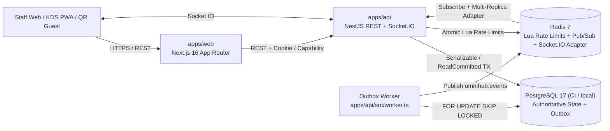

# Architecture

OMNIHUB is a strict TypeScript monorepo (`pnpm` workspaces) implementing core restaurant operations across POS ordering, inventory reservation, offline-capable kitchen display, QR table ordering, payments, and cashier shift reconciliation.

## Monorepo Layout

- `apps/web`: Next.js `16.4.6` App Router frontend (React 19, TypeScript 5.9, `socket.io-client`), including bilingual (`vi`/`en`) staff workspaces, an offline-capable Kitchen Display System (KDS) PWA using IndexedDB (`omnihub-kitchen-v1`) and `/sw.js`, and mobile QR customer ordering routes.
- `apps/api`: NestJS `12.2` REST API (Express 5), Socket.IO `4.8` gateway, and standalone outbox worker entrypoint (`apps/api/src/worker.ts`).
- `packages/contracts`: Shared Zod `4.6` request, response, and realtime event schemas (`@omnihub/contracts`).
- `prisma`: Single PostgreSQL schema (`36` models, `4` enums, `13` additive migrations including `CHECK` constraints and immutability triggers) and an idempotent local sample data seeder (`prisma/seed.ts`).

## Runtime Topology

## Backend Structure & Module Organization

`apps/api` is currently organized as a single-controller monolith with domain-separated service classes rather than full NestJS feature modules:

- `apps/api/src/http.ts` exposes all HTTP routes through `ApiController` inside `AppModule`, instantiating shared domain services (`Operations`, `Payments`, `CashShifts`, `Catalog`, `QrOrdering`, `PilotAdmin`) at module scope instead of NestJS dependency-injection feature modules.
- Domain boundaries are separated by file: `domain.ts`, `commands.ts`, `operations.ts`, `catalog.ts`, `catalog-domain.ts`, `payments.ts`, `cash-shifts.ts`, `qr-ordering.ts`, `pilot-admin.ts`, `auth.ts`, `rate-limit.ts`, `outbox.ts`, `realtime.ts`, and `observability/`.
- Refactoring `ApiController` into isolated NestJS feature modules with constructor-injected providers (tracked internally as `M2-T12`) is explicitly pending and documented in [KNOWN_LIMITATIONS.md](KNOWN_LIMITATIONS.md).

## Data Authority & Concurrency Controls

- **PostgreSQL as Single Source of Truth:** All business mutations commit to PostgreSQL via Prisma (`6.19`) — PostgreSQL `17` in CI (`.github/workflows/ci.yml`) and local Docker Compose (`docker-compose.yml`); local staging and backup containers currently use PostgreSQL `18` (`deploy/compose.staging.yml`, `deploy/backup/Dockerfile`). Multi-row inventory, order, payment, shift, and kitchen-device mutations run in `Serializable` transactions wrapped by `runSerializableTransactionWithRetry` (`apps/api/src/database.ts`), which retries strictly on Prisma `P2034` serialization conflicts (max 3 attempts with bounded jittered backoff) before returning `409`.
- **Deadlock Prevention & Database Invariants:** Ingredient reservations lock rows in deterministic sorted `ingredientId` order and enforce atomic conditional updates (`"onHand" - "reserved" >= quantity`). Database `CHECK` constraints enforce `onHand >= reserved >= 0` and integer VND bounds, while PostgreSQL triggers (`reject_ledger_mutation()`) make `Movement`, `Audit`, and `Payment` rows append-only.
- **Idempotency:** Mutating endpoints require an `Idempotency-Key` stored in `CommandReceipt` scoped to `(tenantId, storeId, key)` with a SHA-256 request digest. Identical replays return the original result without duplicating side effects; key reuse with a different payload returns `409`.
- **High-Frequency Kitchen Heartbeats:** Registered kitchen device heartbeats (`POST /kitchen/devices/register`) use an atomic conditional `ReadCommitted` `updateMany` (`WHERE revokedAt IS NULL`) so concurrent heartbeats serialize on the row lock via PostgreSQL `EvalPlanQual` without triggering `P2034` bursts, while initial registration, station assignment, and revocation remain `Serializable`.

## Realtime & Transactional Outbox

- Business transactions write `Audit` and `Outbox` rows in the same PostgreSQL commit as domain state changes.
- `apps/api/src/worker.ts` polls undelivered outbox rows using `FOR UPDATE SKIP LOCKED` inside a bounded batch time budget (`10s` within a `15s` transaction timeout), validates event contracts, and publishes to Redis Pub/Sub (`omnihub.events`) with at-least-once delivery semantics.
- `apps/api/src/realtime.ts` attaches `@socket.io/redis-adapter` for multi-replica fan-out, deduplicates incoming `eventId`s with a bounded FIFO cache, and broadcasts only to server-selected `(tenantId, storeId)` or order-tracking rooms. Clients treat socket events as invalidation triggers and re-fetch authoritative REST state.
- Revocation events (`session.revoked`, `kitchen.device.changed`) trigger immediate best-effort publish plus durable outbox fallback so revoked sessions and kitchen devices are disconnected across replicas.

## Security & Observability Boundaries

- **Authentication & Multi-Tenancy:** Passwords use Node `scrypt` with per-user salts. Staff sessions use 256-bit opaque tokens stored as SHA-256 hashes in PostgreSQL (`HttpOnly`, `SameSite=Strict`, `Secure` outside local HTTP dev, 8-hour expiry). Every route and transaction enforces `(tenantId, storeId)` scope and active membership revalidation.
- **Rate Limiting & Fail-Closed Ingress:** Public and auth routes use atomic Redis Lua scripts (`EVAL`, `INCR`, `PEXPIRE`, `PTTL` — no `DEL` for Redis 7 ACL compatibility) and fail closed with `503` if Redis is unavailable. `POST /auth/login` combines an IP window limit with a per-account SHA-256 failure lockout (`10` failures / `15` minutes) checked before `scrypt`.
- **Capability Tokens:** QR table credentials, customer table sessions, order tracking tokens, and employee invitations are stored only as SHA-256 digests and masked in logs.
- **Observability:** Single-line structured JSON logs (`application`, `security`, `operational`) propagate validated `X-Correlation-ID` headers across HTTP `AsyncLocalStorage` and outbox batches. Internal Prometheus metrics (`GET /metrics`) expose HTTP golden signals, domain counters, and outbox/realtime telemetry, restricted to Bearer token or unproxied loopback and blocked at the reverse proxy edge.

## Further Reading

- [ORDER-TO-CASH-FLOW.md](ORDER-TO-CASH-FLOW.md) — End-to-end order, kitchen, inventory, payment, and shift lifecycle.
- [KNOWN_LIMITATIONS.md](KNOWN_LIMITATIONS.md) — Current technical boundaries, out-of-scope features, and pilot NO-GO status.
- Architecture Decision Records: [ADR-0001](adr/0001-serializable-inventory-ledger.md), [ADR-0002](adr/0002-transactional-outbox-and-redis-adapter.md), [ADR-0003](adr/0003-kitchen-device-sync-and-revocation.md).
- Detailed design specs and historical audit notes are preserved under [docs/internal/](internal/).
