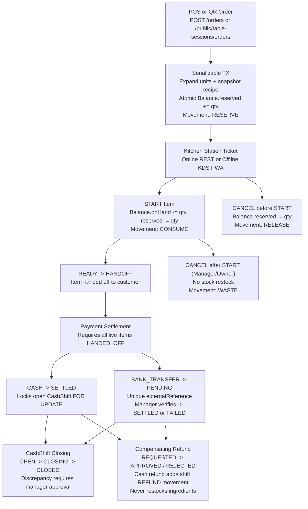

# Order-to-Cash Flow

This document describes the implemented lifecycle from order creation through kitchen preparation, inventory accounting, payment settlement, and cashier shift closing. All currency calculations use integer VND; all ingredient quantities use `Decimal(18,3)` in base units (`g`, `ml`, `piece`).

## 1. Order Acceptance & Inventory Reservation

- **Entry points:** Staff submit POS orders via `POST /orders`; dine-in guests submit QR orders via `POST /public/table-sessions/orders` using a 4-hour table session token derived from a rotatable QR capability (`apps/api/src/operations.ts`, `apps/api/src/qr-ordering.ts`).
- **Server-side pricing & recipe snapshotting:** The API ignores client-supplied totals. It expands each ordered line into individual `OrderItem` units (max 100 units per order), computes exact integer VND unit prices from product, variant, and modifier selections (`selectionPrice`), and stores immutable `recipeSnapshot` and `selectionSnapshot` payloads per unit.
- **Atomic stock reservation:** Required ingredient totals are sorted by `ingredientId` and reserved via conditional SQL updates (`"onHand" - "reserved" >= quantity`). If any ingredient lacks available stock, the entire transaction rolls back with `409 INSUFFICIENT_STOCK`. Successful reservations create `KitchenTicket` rows grouped by station, `Reservation` records (`RESERVED`), `Movement` ledger rows (`RESERVE`), `Audit`, and `Outbox` entries in one `Serializable` commit.

## 2. Kitchen Preparation & Offline KDS Sync

- **Online commands (`POST /items/:id/commands`):** Items advance `PENDING -> PREPARING (START) -> READY (READY) -> HANDED_OFF (HANDOFF)`. Orders carry an optimistic `version` counter checked on every transition (`expectedVersion`).
- **Inventory transitions:**
  - `START` atomically decrements both `Balance.onHand` and `Balance.reserved`, updates `Reservation.status` to `CONSUMED`, and appends a `CONSUME` movement.
  - `CANCEL` on a `PENDING` item releases `Balance.reserved`, marks the reservation `RELEASED`, and appends a `RELEASE` movement.
  - `CANCEL` on a started item (`PREPARING`, `READY`, or `HANDED_OFF`) requires `OWNER` or `MANAGER` permission (`cancelStarted`), does **not** return ingredients to stock, and appends a `WASTE` movement recording the consumed quantity.
- **Offline KDS replay (`POST /kitchen/sync`):** Registered kitchen devices cache scoped tickets in IndexedDB (`omnihub-kitchen-v1`) and queue strictly ordered `START` and `READY` commands while offline. On reconnect, the server validates device authorization (`revokedAt IS NULL`), locks the device row `FOR SHARE` during each item command, and stops per-order replay on any conflict (`CONFLICT` / `REJECTED`), marking subsequent commands for that order `BLOCKED` for manual staff review instead of silently overwriting server state.

## 3. Payments, Splits & Compensating Refunds

- **Payability precondition:** An order can only accept payments (`POST /orders/:id/payments`) while `status = ACCEPTED` and every non-cancelled `OrderItem` has reached `HANDED_OFF`. Overpayment beyond `totalDue` is rejected (`409 OVERPAYMENT_NOT_ALLOWED`).
- **Bill splits (`POST /orders/:id/splits`):** Staff can split an order by explicit integer amount or by non-overlapping `itemIds`. Payments can optionally attach to a `splitId`, rejecting allocations that exceed the split amount.
- **Payment methods (`apps/api/src/payments.ts`):**
  - `CASH`: Requires `tendered >= amount` and an `OPEN` `CashShift` belonging to the cashier, locked `FOR UPDATE`. Creates a `SETTLED` payment immediately and updates `Order.paymentStatus` to `PAID` (and `Order.status` to `COMPLETED`) once settled payments cover `order.total`.
  - `BANK_TRANSFER`: Requires a unique `externalReference` and records a `PENDING` payment. An `OWNER` or `MANAGER` must explicitly call `POST /payments/:id/verify` (`SETTLED`) or `POST /payments/:id/fail` (`FAILED`).
  - `CARD`: Routed through `LabeledCardSandboxAdapter` (`SANDBOX_ONLY`), which intentionally rejects all card authorization attempts. No live payment gateway or webhook handler is implemented.
- **Compensating refunds:** Cashiers or managers request a refund against a `SETTLED` payment (`POST /payments/:id/refunds`, creating a `REQUESTED` record with a reason). Approval or rejection (`POST /refunds/:id/decision`) requires `cashApprove` permission (`OWNER`/`MANAGER`). Approved cash refunds require an open cash shift and append a compensating `REFUND` `CashMovement`; non-cash refund disbursement occurs outside the application. Refunds never mutate original `Payment` rows and never restock consumed ingredients.

## 4. Cashier Shift Reconciliation

- **Lifecycle (`apps/api/src/cash-shifts.ts`):** Shifts belong to a `CashRegister` and assigned cashier, stamped with a store business date (`Asia/Ho_Chi_Minh`, configurable `dayStart` cutoff, default `04:00`).
- **Open & cash movements:** While `OPEN`, cash payments link to `cashShiftId`, and manual drawer movements (`CASH_IN`, `CASH_OUT`, `REFUND`) lock the shift `FOR UPDATE` and validate that expected drawer balance remains within valid bounds (`cashExpected`).
- **Closing & discrepancy approval:** Closing (`POST /cash-shifts/:id/close`) locks the shift `FOR UPDATE`, computes `discrepancy = countedAmount - expectedAmount`, and transitions directly to `CLOSED` (`approvalStatus = NOT_REQUIRED`) when discrepancy is `0`. Any non-zero discrepancy requires a reason (minimum 5 characters), leaves the shift in `CLOSING` (`approvalStatus = PENDING`), and requires an `OWNER`/`MANAGER` approval (`POST /cash-shifts/:id/approve`) before transitioning to `CLOSED`.
