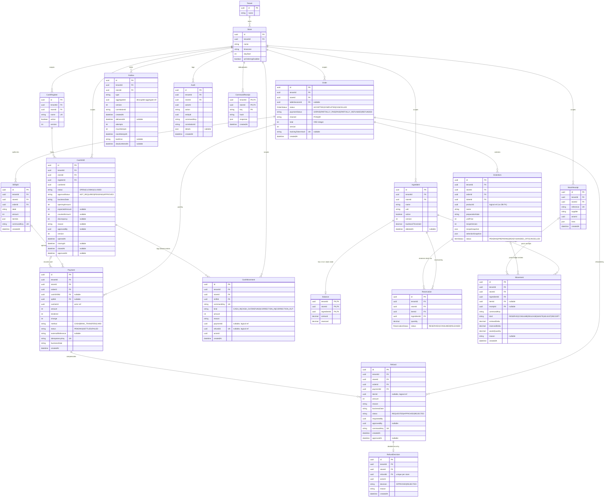
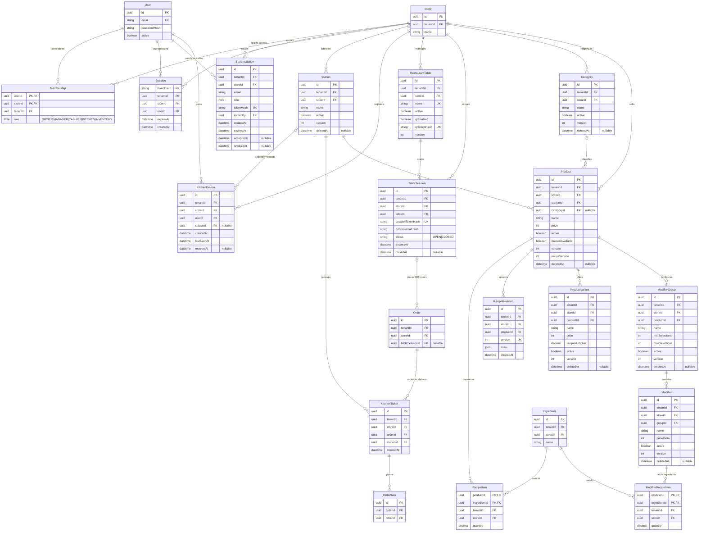

# OMNIHUB Database Entity Relationship Diagram (ERD)

This document describes the PostgreSQL data model implemented in [`prisma/schema.prisma`](../prisma/schema.prisma) (`36` Prisma models across `14` migrations). Every store-scoped table carries `(tenantId, storeId)` and enforces composite foreign keys with `ON DELETE RESTRICT` so cross-tenant references are rejected at the database layer.

---

## 1. Core Financial, Order, Inventory & Outbox ERD

This diagram covers the primary transactional, accounting, inventory ledger, and event delivery models.

---

## 2. Authentication, Kitchen Operations, QR Ordering & Catalog ERD

This diagram documents the remaining identity, access control, kitchen ticket/device, QR table session, and menu catalog models in [`prisma/schema.prisma`](../prisma/schema.prisma).

---

## 3. Key Financial, Operational & Integrity Relationships

### Tenant and Store Ownership
- `Tenant` owns one or more `Store` rows (`Store.tenantId -> Tenant.id`, composite unique `@@unique([tenantId, id])`).
- All operational tables carry `(tenantId, storeId)` and reference composite keys on parent entities (for example, `Order` -> `Store(tenantId, id)`, `Payment` -> `Order(tenantId, storeId, id)`, `CashShift` -> `CashRegister(tenantId, storeId, id)`), preventing cross-tenant or cross-store joins even if an application query omits a filter.
- `User` accounts exist globally by unique `email` and join stores via `Membership` (`@@id([userId, storeId])`). `Session` rows bind a hashed cookie token (`tokenHash`) to one `(tenantId, storeId, userId)`.

### Order-to-Payment-to-Refund Accounting
- **Order -> Payment (1:N):** An `Order` can have multiple `Payment` records (`CASH`, `BANK_TRANSFER`, or sandbox `CARD`), supporting partial payments and split bills. `Payment.splitId` is an optional FK to `BillSplit`, and `Payment.cashShiftId` is an optional FK to `CashShift` (populated for `CASH` payments).
- **Payment -> Refund (1:N) & Refund -> RefundDecision (1:0..1):** Refunds are compensating entries tied by FK to both `Order` and a `SETTLED` `Payment` — settled payments are never mutated or deleted. `RefundDecision` enforces `@@unique([tenantId, storeId, refundId])`, guaranteeing at most one approval or rejection record per refund.
- **Order payment state invariant:** PostgreSQL `CHECK` constraint `order_payment_terminal` ensures `COMPLETED` orders have `paymentStatus` in `('PAID', 'PARTIALLY_REFUNDED', 'REFUNDED')`, `ACCEPTED` orders allow `('UNPAID', 'PARTIALLY_PAID', 'PARTIALLY_REFUNDED', 'REFUNDED')` (supporting refunds against partially paid orders), and `CANCELLED` orders remain `UNPAID`.

### Cash Shifts and Cash Movements
- **CashRegister -> CashShift (1:N) -> CashMovement (1:N):** Each `CashRegister` hosts sequential `CashShift` sessions (`OPEN -> CLOSING -> CLOSED`). Cash drawer additions/deductions are recorded as append-only `CashMovement` entries (`CASH_IN`, `CASH_OUT`, `REFUND`, `CORRECTION_IN`, `CORRECTION_OUT`).
- **Logical references on `CashMovement`:** `CashMovement.paymentId` and `CashMovement.refundId` (`@@unique([tenantId, storeId, refundId])`) link cash refund movements back to `Payment` and `Refund` at the application and unique-index level rather than via direct Prisma `@relation` FKs.
- **Database immutability & discrepancy enforcement:** `CashShift_discrepancy_approval_check` prevents closing a shift with a non-zero discrepancy unless approved (`approvalStatus = 'APPROVED'`, `approvedBy IS NOT NULL`, `approvedAt IS NOT NULL`), and trigger `protect_closed_cash_shift()` forbids `DELETE` on any `CashShift` row and updates to `CLOSED` shifts.

### Order-to-Inventory Ledger
- **Ingredient <-> Balance (1:0..1):** `Balance` uses a composite primary key `(tenantId, storeId, ingredientId)` referencing `Ingredient`, storing `onHand` and `reserved` in `Decimal(18,3)`.
- **OrderItem -> Reservation (1:N) & Movement (1:N):** Accepting an order creates `Reservation` (`RESERVED`) rows and `Movement(kind = 'RESERVE')` entries per ingredient. Starting preparation transitions reservations to `CONSUMED` (`Movement(CONSUME)`); cancelling pending items transitions them to `RELEASED` (`Movement(RELEASE)`); cancelling started items posts `Movement(WASTE)`.
- **StockReceipt -> Movement (1:N):** Receiving stock creates an immutable `StockReceipt` and corresponding `Movement(kind = 'RECEIPT')` entries. `Movement.itemId` and `Movement.receiptId` are mutually optional FKs depending on the movement kind.
- **Historical recipe snapshots:** `OrderItem.productId` is stored as a logical UUID without a DB FK, and `OrderItem.recipeSnapshot` / `selectionSnapshot` capture the exact recipe and modifiers at order time so later catalog edits never alter historical orders.

### Transactional Outbox, Audit & Idempotency
- **Outbox -> Store (N:1, decoupled aggregate reference):** `Outbox` has a direct FK to `Store(tenantId, id)` and references domain records logically via `(type, aggregateId, version)`. Mutations persist business state, `Audit`, `CommandReceipt`, and `Outbox` rows in the same `Serializable` PostgreSQL transaction.
- **Retry & Dead Letter Queue state:** Migration `202611280001_financial_security_hardening` added `attempts`, `maxAttempts`, `nextAttemptAt`, `lastError`, and `deadLetteredAt` with `CHECK` constraint `Outbox_retry_integrity` (`attempts >= 0`, `maxAttempts >= 1`, and mutually exclusive `deliveredAt` / `deadLetteredAt`) plus partial indexes `Outbox_pending_ready_idx` and `Outbox_dead_letter_idx`.
